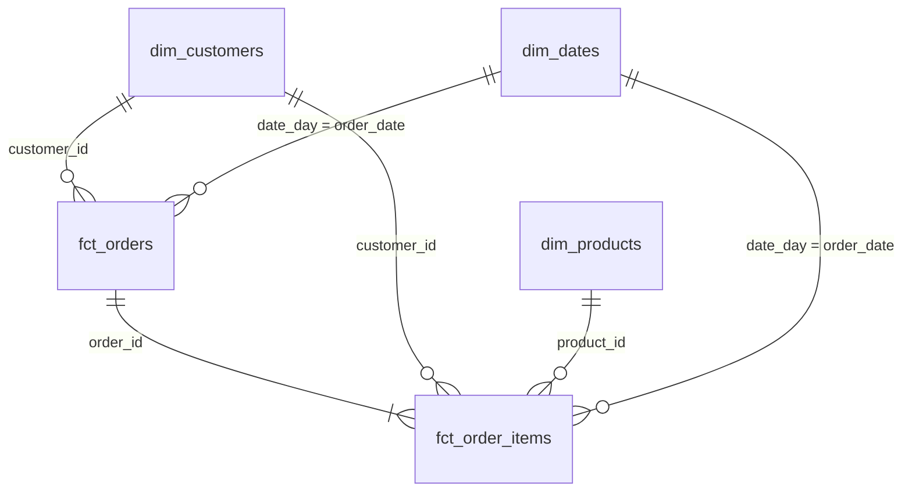
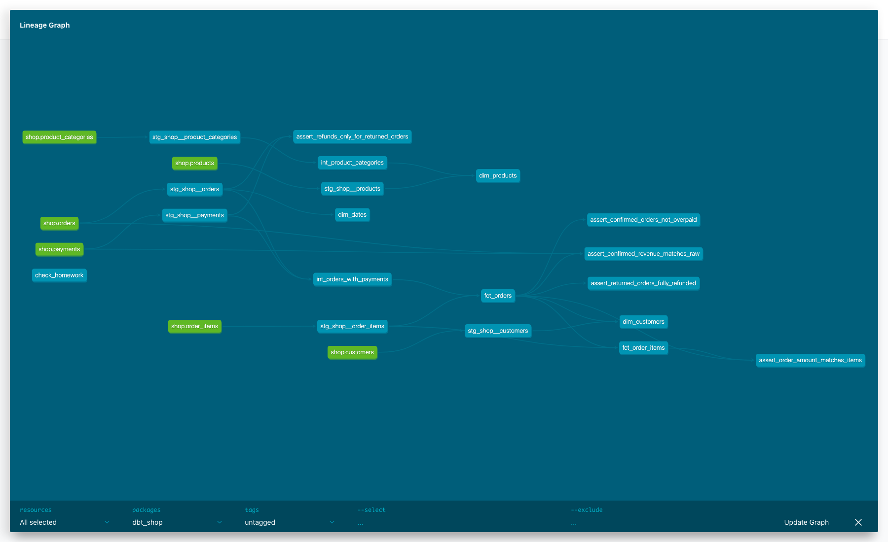

# store_hse — витрины интернет-магазина

В этом проекте на основе данных интернет-магазина создаются аналитические витрины в Greenplum с помощью dbt. Исходные данные хранятся в PostgreSQL и загружаются в Greenplum через loader.

## Модель данных



| Витрина | Зернистость | Бизнес-вопрос |
|---|---|---|
| fct_orders | Нетестовый заказ | Выручка, средний чек по городам, возвраты |
| fct_order_items | Товар в нетестовом заказе | Выручка по категориям, возвраты по брендам |
| dim_customers | Все зарегистрированные клиенты | Доля покупателей по каналам, первая покупка |
| dim_products | Товар с брендом и иерархией категорий | Продажи по товарам и корневым категориям |
| dim_dates | День, включая дни без заказов | Отчёты по месяцам, кварталам и выходным |

Слои проекта:

- `analytics_staging` — 6 view, по одной на таблицу источника. Здесь используются `source()`, переименование полей и простые вычисления без JOIN и агрегаций.
- `analytics_intermediate` — промежуточные модели, в которых рассчитываются суммы платежей и обрабатывается иерархия категорий.
- `analytics_marts` — 5 таблиц фактов и измерений. Модели читают данные через `ref()`.

Подтверждённая покупка — заказ со статусом `paid` и хотя бы одной успешной оплатой без возврата.
Возврат — успешная операция с отрицательной суммой; неуспешные и ожидающие платежи в суммы не входят.
`net_paid_amount` — оплачено минус возвращено. Выручка считается по стоимости подтверждённых заказов или их позиций.
`items_count` — число разных товаров в заказе.

Первая покупка клиента выбирается по времени заказа, при равенстве — по `order_id`.
Клиенты без покупок остаются в `dim_customers`: первая покупка — NULL, количество и выручка — 0, `is_buyer=false`.
Календарь `dim_dates` строится через `dbt_utils.date_spine` и включает все дни от первой до последней даты заказа.
День недели: 1 — понедельник, 7 — воскресенье.

## Хранение в Greenplum

| Витрина | Распределение | Хранение и причина |
|---|---|---|
| fct_orders | BY (order_id) | Колоночное: удобно для отчётов, которые читают отдельные поля |
| fct_order_items | BY (order_id) | Колоночное: удобно для расчёта выручки и соединения с заказами |
| dim_customers | REPLICATED | Heap: небольшой справочник, копия на каждом сегменте |
| dim_products | REPLICATED | Heap: небольшой справочник, JOIN без пересылки фактов |
| dim_dates | REPLICATED | Heap: небольшой календарь, JOIN без пересылки фактов |

Настройки заданы в `config()` каждой витрины. Оба факта и исходные таблицы заказов,
позиций и платежей распределены по `order_id`, поэтому соединяются по общему ключу
без перераспределения строк. Если распределить позиции по `product_id`, для JOIN с заказами потребуется пересылка данных между сегментами.

## Запуск

Нужен работающий Docker Desktop. Из корня проекта выполните:

```sh
docker compose up -d
docker compose logs loader
# Дождаться сообщения «Готово» от loader.
docker compose run --rm dbt deps
docker compose run --rm dbt build
```

`dbt deps` устанавливает пакет `dbt_utils`, закреплённый в `packages.yml` и `package-lock.yml`.

Для просмотра документации:

```sh
docker compose run --rm dbt docs generate
docker compose run --rm --service-ports dbt docs serve --host 0.0.0.0 --port 8080
```

Откройте http://localhost:8080. Граф зависимостей доступен по кнопке внизу справа.



## Тесты и результаты

Ключи staging и marts проверяются через `unique` и `not_null`, связи — через `relationships`,
статусы заказов и платежей — через `accepted_values`. Собственный generic-тест
`non_negative` проверяет суммы, количества и скидки.

Пять singular-тестов проверяют:

- совпадение суммы заказа с суммой позиций,
- совпадение подтверждённой выручки с независимым расчётом по raw orders и payments,
- полный возврат денег по возвращённым заказам,
- отсутствие переплаты у подтверждённых заказов,
- наличие возвратов только у заказов со статусом `returned`.

Результат сборки в Docker: **PASS=124, WARN=1, ERROR=0**.
Контрольные значения совпали. Запросы для самопроверки находятся в [analyses/check_homework.sql](analyses/check_homework.sql).

### Предупреждение для заказа 113

Заказ стоит 200 руб., но по нему прошли две успешные оплаты по 200 руб.
Поэтому `paid_amount` и `net_paid_amount` равны 400 руб. Тест
`assert_confirmed_orders_not_overpaid` имеет `severity='warn'` и находит этот заказ.
Исходные данные сохранены; выручка заказа остаётся 200 руб. Это ожидаемый WARN, остальные тесты прошли.

